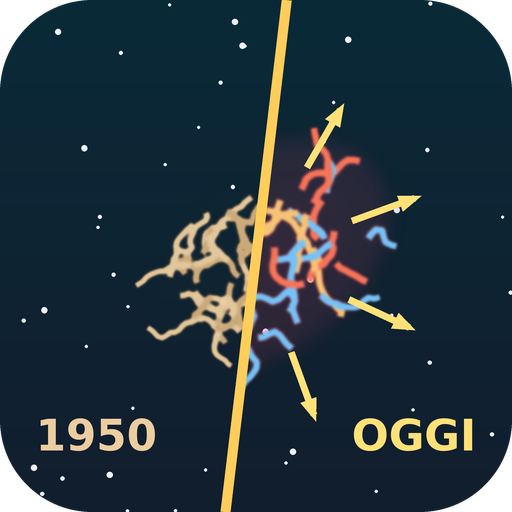

<p align="center"></p>

# Before and After

*Measure how the sky changes: nebula expansion and proper motions from survey images taken decades apart* — original Italian name: «Prima e dopo»

Compares images of the same field taken decades apart (POSS-I 1950s, DSS2, Pan-STARRS, Hubble…), aligns them on the stars that do not move, and measures expansions and motions. For the Crab Nebula (M 1) it dates the explosion from the expansion; it does the same for Cassiopeia A and Eta Carinae's Homunculus, and measures the proper motions of fast stars such as Barnard's Star and 61 Cygni.

## Features

* Nine automatic objects (M 1, Cas A, Barnard's Star, Groombridge 1830, 61 Cygni, Lalande 21185, NGC 2261, NGC 1555, Homunculus)
* True observation dates (DSS headers from STScI and ESO), pairs of epochs as a consistency check
* Only stationary stars are masked; outer-shell analysis for M 1
* Synthetic test (`prova_sintetica.py`)

## Tested on real data

M 1, outer shell 1951→2012: explosion year **1104 ± 18** (historical: 1054; literature from expansion 1130–1140). Eta Carinae, Hubble F658N 1997→2018: **1836** (Great Eruption: 1843).

> **Language note.** The interface is in **Italian** (large, adjustable text); plots, PDF/PNG cards and scientific output are in **English**. Code comments are in Italian. The original Italian guide is [`LEGGIMI.txt`](LEGGIMI.txt).

**Version:** 1.10 (2026-11-10). **Status:** 1.9 built and tested; 1.10 (Homunculus improvements) not yet built.

## Quick start

Requirements: Python 3.10+ (tested with Python 3.14 on Ubuntu) with `tkinter` (Ubuntu: `sudo apt install python3-tk`).

```bash
git clone https://github.com/EDOKILLER/before-and-after.git
cd before-and-after
python3 -m pip install -r requirements.txt

python3 prima_e_dopo.py --autotest
python3 prima_e_dopo.py --diagnostica
python3 prima_e_dopo.py        # opens the window
```

### Standalone executable

`bash crea_eseguibile_ubuntu.sh` builds a single-file executable with PyInstaller in a temporary virtual environment, runs the self-test, and adds the program with its icon to the application menu and the desktop (first time on GNOME: right-click → *Allow launching*).

The build scripts were written for the author's machine: check the paths at the top before running them.

## Data sources and acknowledgements

Data are downloaded at run time from public services. If you publish results, please follow their acknowledgement policies:

* [Digitized Sky Survey (STScI and ESO servers)](https://archive.stsci.edu/cgi-bin/dss_form)
* [ESO Science Archive](https://archive.eso.org/)
* [Pan-STARRS1 surveys (via MAST)](https://outerspace.stsci.edu/display/PANSTARRS/)
* [Mikulski Archive for Space Telescopes (STScI): Hubble, JWST, Kepler, TESS, GALEX, Pan-STARRS](https://archive.stsci.edu/)
* [NASA/IPAC Extragalactic Database](https://ned.ipac.caltech.edu/)

This project is independent and not endorsed by any of these institutions.

## License

Code: [BSD 3-Clause](LICENSE) © 2026 Edoardo Battistel. You can use, modify and redistribute it, also commercially, as long as you keep the copyright notice; the author's name may not be used to promote derived works without permission. If you use it in research, see [`CITATION.cff`](CITATION.cff).

---
Part of a series of astronomy programs by Edoardo Battistel — see also [X-rays from Black Holes](https://github.com/EDOKILLER/x-rays-from-black-holes) and the other repositories on [this profile](https://github.com/EDOKILLER?tab=repositories).
